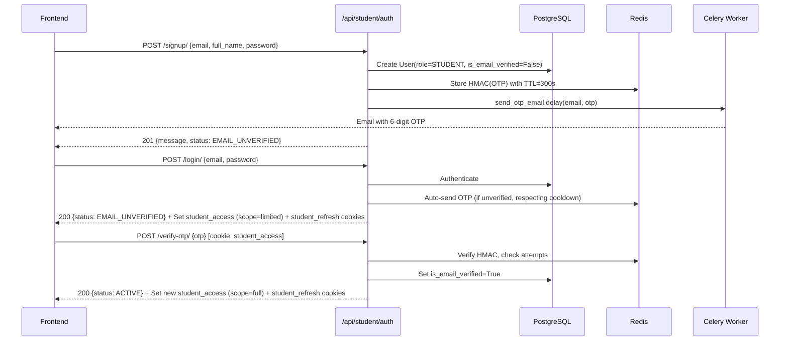
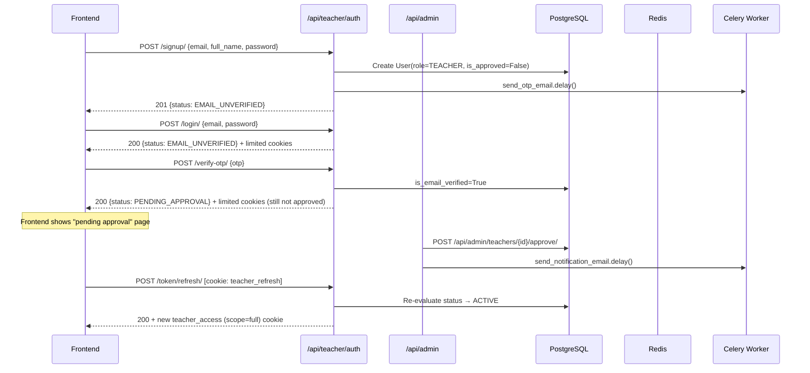
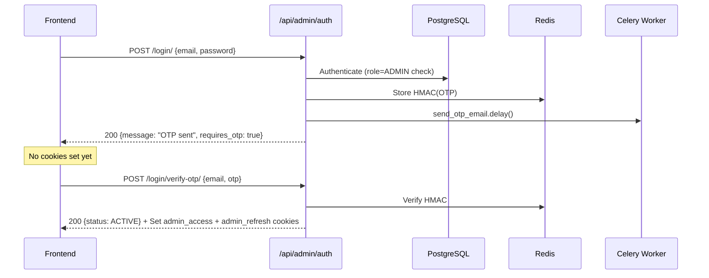
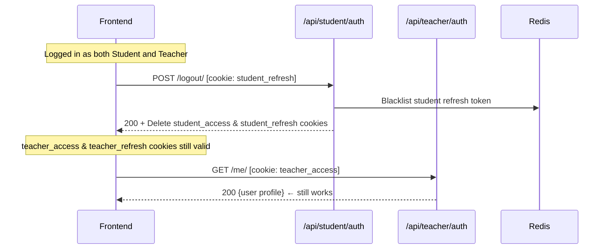

# LMS Authentication Foundation — Implementation Plan

> **Status**: Awaiting approval. No code will be written until you confirm.

---

## 1. Dependency List

### Python packages (`requirements.txt`)

| Package | Purpose |
|---|---|
| `Django>=5.1,<6` | Web framework (downgrade from 6.x to 5.x per spec) |
| `djangorestframework>=3.15` | REST API |
| `djangorestframework-simplejwt>=5.3` | JWT tokens |
| `drf-spectacular>=0.27` | OpenAPI / Swagger / ReDoc |
| `django-environ>=0.11` | Config from `.env` (replaces `python-dotenv`) |
| `django-cors-headers>=4.4` | CORS with credentials |
| `django-redis>=5.4` | Redis cache backend |
| `celery[redis]>=5.4` | Async task queue |
| `redis>=5.0` | Redis client |
| `psycopg[binary]>=3.2` | PostgreSQL driver |
| `gunicorn>=22` | Production WSGI server |
| `pytest>=8` | Test runner |
| `pytest-django>=4.8` | Django test integration |
| `fakeredis[lua]>=2.23` | In-memory Redis for tests |
| `factory-boy>=3.3` | Test factories |
| `ruff>=0.5` | Linting + formatting |

**Removed**: `pymongo`, `python-dotenv`

### Docker Compose services

| Service | Image | Ports |
|---|---|---|
| `web` | Custom Dockerfile (Python 3.12-slim) | `8000:8000` |
| `postgres` | `postgres:16-alpine` | `5432:5432` |
| `redis` | `redis:7-alpine` | `6379:6379` |
| `celery_worker` | Same image as `web` | — |

### Redis DB allocation

| DB | Purpose |
|---|---|
| `0` | Django cache (user state lookups) |
| `1` | OTP storage + rate limiting |
| `2` | Celery broker |
| `3` | Celery result backend |

---

## 2. Project Structure

```
d:\backend\
├── manage.py                       # Updated: DJANGO_SETTINGS_MODULE -> config.settings.dev
├── requirements.txt
├── .env.example                    # Complete env var reference
├── .env                            # Local dev (gitignored)
├── .gitignore
├── Dockerfile
├── docker-compose.yml
├── pytest.ini                      # (or pyproject.toml section)
├── ruff.toml
├── README.md
│
├── config/                         # Replaces lms/ as the config package
│   ├── __init__.py
│   ├── asgi.py
│   ├── wsgi.py
│   ├── urls.py                     # Root URL conf
│   ├── celery.py                   # Celery app + autodiscover
│   └── settings/
│       ├── __init__.py             # Empty (or re-exports dev for convenience)
│       ├── base.py                 # All shared settings
│       ├── dev.py                  # DEBUG=True, console email, CORS allow-all, etc.
│       └── prod.py                 # Secure cookies, SMTP email, strict CORS
│
├── apps/
│   ├── __init__.py
│   │
│   ├── accounts/                   # User model, profiles, admin, managers
│   │   ├── __init__.py
│   │   ├── apps.py
│   │   ├── models.py              # User, TeacherProfile, StudentProfile
│   │   ├── managers.py            # UserManager
│   │   ├── admin.py               # Register User + profiles
│   │   ├── signals.py             # Auto-create profiles on user creation
│   │   ├── serializers.py         # Teacher list/approve serializers (admin-facing)
│   │   ├── views.py               # Admin teacher-management views
│   │   ├── urls.py                # /api/admin/teachers/...
│   │   ├── management/
│   │   │   └── commands/
│   │   │       └── create_admin.py
│   │   ├── migrations/
│   │   └── tests/
│   │       ├── __init__.py
│   │       ├── test_models.py
│   │       └── test_admin_views.py
│   │
│   ├── authentication/            # Auth endpoints, JWT cookie handling, OTP views
│   │   ├── __init__.py
│   │   ├── apps.py
│   │   ├── services.py            # OTPService (Redis HMAC, cooldown, attempts)
│   │   ├── serializers.py         # Signup, Login, OTP, PasswordReset, Me, etc.
│   │   ├── views.py               # All auth views (signup, login, verify, etc.)
│   │   ├── urls.py                # Role-prefixed auth URL patterns
│   │   ├── tokens.py              # Custom TokenObtainPair + role claim + scope claim
│   │   ├── cookie_utils.py        # Set/delete/read role-specific JWT cookies
│   │   ├── schemas.py             # drf-spectacular extensions (OpenApiAuthenticationExtension)
│   │   └── tests/
│   │       ├── __init__.py
│   │       ├── test_otp.py
│   │       ├── test_student_flow.py
│   │       ├── test_teacher_flow.py
│   │       ├── test_admin_flow.py
│   │       ├── test_role_isolation.py
│   │       └── test_throttling.py
│   │
│   └── core/                      # Shared infra: permissions, auth classes, tasks
│       ├── __init__.py
│       ├── apps.py
│       ├── permissions.py         # IsAdminRole, IsTeacherRole, IsStudentRole,
│       │                          # HasFullScope, AllowLimitedScope, composites
│       ├── authentication.py      # Base + 3 role-specific JWTCookieAuthentication classes
│       ├── throttles.py           # EmailRateThrottle, IPRateThrottle (Redis-backed)
│       ├── exceptions.py          # Custom exception handler, standard error format
│       ├── renderers.py           # (optional) consistent JSON envelope
│       ├── utils.py               # Helpers (e.g. get_user_status)
│       ├── tasks.py               # send_otp_email, send_notification_email (Celery)
│       ├── views.py               # Per-role dashboard/ping endpoints
│       ├── urls.py                # /api/{role}/dashboard/ping/
│       └── templates/
│           └── emails/
│               ├── otp.html
│               ├── otp.txt
│               ├── teacher_approved.html
│               ├── teacher_approved.txt
│               ├── teacher_rejected.html
│               └── teacher_rejected.txt
│
└── lms/                            # Old config dir — will be DELETED
```

> [!IMPORTANT]
> The old `lms/` config package and the `users/` app will be **removed**. The `mango.py` and `lms/mongo.py` files will also be deleted (MongoDB out of scope).

---

## 3. Models

### `accounts.User`

```python
class User(AbstractBaseUser, PermissionsMixin):
    class Role(models.TextChoices):
        ADMIN = "ADMIN", "Admin"
        TEACHER = "TEACHER", "Teacher"
        STUDENT = "STUDENT", "Student"

    id          = UUIDField(primary_key=True, default=uuid4, editable=False)
    email       = EmailField(unique=True)                # USERNAME_FIELD
    full_name   = CharField(max_length=255)
    role        = CharField(max_length=10, choices=Role, default=Role.STUDENT)
    is_email_verified = BooleanField(default=False)
    is_approved       = BooleanField(default=True)       # overridden per role in manager
    is_active         = BooleanField(default=True)
    is_staff          = BooleanField(default=False)
    date_joined       = DateTimeField(auto_now_add=True)
    last_login        = DateTimeField(null=True, blank=True)

    USERNAME_FIELD = "email"
    REQUIRED_FIELDS = ["full_name"]
    objects = UserManager()
```

**Role defaults** (enforced in `UserManager.create_user`):
- `STUDENT` → `is_approved=True`
- `TEACHER` → `is_approved=False`
- `ADMIN` → `is_approved=True`, `is_email_verified=True`, `is_staff=True`

### `accounts.TeacherProfile`

```python
class TeacherProfile(models.Model):
    user       = OneToOneField(User, on_delete=CASCADE, related_name="teacher_profile")
    phone      = CharField(max_length=20, blank=True)
    department = CharField(max_length=255, blank=True)
    bio        = TextField(blank=True)
    created_at = DateTimeField(auto_now_add=True)
    updated_at = DateTimeField(auto_now=True)
```

### `accounts.StudentProfile`

```python
class StudentProfile(models.Model):
    user           = OneToOneField(User, on_delete=CASCADE, related_name="student_profile")
    phone          = CharField(max_length=20, blank=True)
    enrollment_id  = CharField(max_length=50, blank=True)
    enrollment_date = DateField(null=True, blank=True)
    created_at     = DateTimeField(auto_now_add=True)
    updated_at     = DateTimeField(auto_now=True)
```

Profile auto-creation happens in a `post_save` signal on `User` (only for TEACHER and STUDENT roles).

---

## 4. Endpoint Table

### Student & Teacher Auth (`/api/{role}/auth/...`)

| Method | Path | Auth | Scope | Description |
|--------|------|------|-------|-------------|
| POST | `/api/{role}/auth/signup/` | None | — | Create user, send OTP. If unverified account exists, resend OTP |
| POST | `/api/{role}/auth/verify-otp/` | Cookie (limited OK) | `limited\|full` | Verify signup OTP, mark verified, return fresh tokens |
| POST | `/api/{role}/auth/resend-otp/` | Cookie (limited OK) | `limited\|full` | Resend OTP (60s cooldown) |
| POST | `/api/{role}/auth/login/` | None | — | Email+password, returns status, sets cookies. Auto-sends OTP if unverified |
| POST | `/api/{role}/auth/token/refresh/` | Cookie (limited OK) | `limited\|full` | Refresh access token; re-evaluates scope |
| POST | `/api/{role}/auth/logout/` | Cookie (limited OK) | `limited\|full` | Blacklist refresh, clear this role's cookies only |
| GET | `/api/{role}/auth/me/` | Cookie (limited OK) | `limited\|full` | User profile + status |
| POST | `/api/{role}/auth/password-reset/request/` | None | — | Send password-reset OTP (no email leak) |
| POST | `/api/{role}/auth/password-reset/confirm/` | None | — | Verify OTP + set new password, invalidate all tokens |

### Admin Auth (`/api/admin/auth/...`)

| Method | Path | Auth | Scope | Description |
|--------|------|------|-------|-------------|
| POST | `/api/admin/auth/login/` | None | — | Step 1: email+password → send OTP (no tokens yet) |
| POST | `/api/admin/auth/login/verify-otp/` | None | — | Step 2: verify OTP → set admin cookies |
| POST | `/api/admin/auth/resend-otp/` | Cookie (limited OK) | `limited\|full` | Resend admin login OTP |
| POST | `/api/admin/auth/token/refresh/` | Cookie | `full` | Refresh admin access token |
| POST | `/api/admin/auth/logout/` | Cookie | `full` | Blacklist + clear admin cookies |
| GET | `/api/admin/auth/me/` | Cookie | `full` | Admin profile |
| POST | `/api/admin/auth/password-reset/request/` | None | — | Password-reset OTP |
| POST | `/api/admin/auth/password-reset/confirm/` | None | — | Verify OTP + set new password |

### Admin Teacher Management (`/api/admin/teachers/...`)

| Method | Path | Auth | Scope | Description |
|--------|------|------|-------|-------------|
| GET | `/api/admin/teachers/?status=pending` | Cookie (Admin) | `full` | List teachers filtered by approval state |
| POST | `/api/admin/teachers/{id}/approve/` | Cookie (Admin) | `full` | Approve teacher, send notification email |
| POST | `/api/admin/teachers/{id}/reject/` | Cookie (Admin) | `full` | Reject teacher, send notification email |

### Dashboard Ping (proof-of-permissions)

| Method | Path | Auth | Scope | Description |
|--------|------|------|-------|-------------|
| GET | `/api/admin/dashboard/ping/` | Cookie (Admin) | `full` | Returns `{"role": "admin", "message": "pong"}` |
| GET | `/api/teacher/dashboard/ping/` | Cookie (Teacher) | `full` | Returns `{"role": "teacher", "message": "pong"}` |
| GET | `/api/student/dashboard/ping/` | Cookie (Student) | `full` | Returns `{"role": "student", "message": "pong"}` |

### Documentation

| Method | Path | Description |
|--------|------|-------------|
| GET | `/api/schema/` | OpenAPI 3.0 schema (YAML/JSON) |
| GET | `/api/docs/` | Swagger UI |
| GET | `/api/redoc/` | ReDoc |

---

## 5. Auth Flows

### 5a. Student Signup → Verify → Active



### 5b. Teacher Signup → Verify → Pending → Approved → Full Token



### 5c. Admin Login (2-Step OTP)



### 5d. Logout Isolation



---

## 6. JWT Cookie Architecture

### Cookie naming & paths

| Role | Access cookie | Refresh cookie | Path scope |
|------|--------------|----------------|------------|
| Admin | `admin_access` | `admin_refresh` | `/api/admin/` |
| Teacher | `teacher_access` | `teacher_refresh` | `/api/teacher/` |
| Student | `student_access` | `student_refresh` | `/api/student/` |

### Cookie flags
- `HttpOnly=True` (always)
- `Secure=True` (prod only, configurable via `JWT_COOKIE_SECURE` env)
- `SameSite` configurable via `JWT_COOKIE_SAMESITE` (default `Lax`)
- Access token lifetime: `JWT_ACCESS_TOKEN_LIFETIME` (default 15 min)
- Refresh token lifetime: `JWT_REFRESH_TOKEN_LIFETIME` (default 7 days)

### Signing keys
Each role uses a separate signing key from env vars:
- `JWT_SIGNING_KEY_ADMIN`
- `JWT_SIGNING_KEY_TEACHER`
- `JWT_SIGNING_KEY_STUDENT`

Tokens contain a `role` claim — even if someone swaps cookies, signature verification fails because the wrong key is used.

### Token blacklisting
Redis-backed blacklist with key pattern: `token_blacklist:{role}:{jti}`, TTL = refresh token remaining lifetime. Checked on every refresh attempt.

### CSRF protection
**Double-submit cookie pattern**:
- On login/refresh, set a non-HttpOnly `csrftoken` cookie with a random value
- Frontend reads this cookie and sends it as the `X-CSRFToken` header
- Auth classes verify header value matches cookie value
- Django's built-in CSRF middleware is used; DRF's `SessionAuthentication` CSRF enforcement is adapted for our cookie auth classes

### Token claims

```json
{
  "token_type": "access",
  "exp": 1234567890,
  "iat": 1234567890,
  "jti": "unique-id",
  "user_id": "uuid",
  "role": "student",
  "scope": "full|limited"
}
```

---

## 7. OTP System Design

| Aspect | Detail |
|--------|--------|
| Length | 6 digits, `secrets.choice` |
| Storage | Redis key: `otp:{purpose}:{email}` → JSON `{hash, attempts, created_at}` |
| Hash | HMAC-SHA256 with `OTP_HMAC_SECRET` env var |
| TTL | 300 seconds (Redis native TTL) |
| Comparison | `hmac.compare_digest` (constant-time) |
| Max attempts | 5 wrong → delete key (force resend) |
| Resend cooldown | 60s, checked via `created_at` in stored value |
| New OTP | Overwrites previous key (invalidates old OTP) |
| Purposes | `signup_verify`, `admin_login`, `password_reset` |
| Email delivery | Celery task with retry (max 3, exponential backoff) |
| Security | Generic response on resend/password-reset (no email existence leak) |

---

## 8. Permission Classes

```python
# core/permissions.py

class IsAdminRole(BasePermission): ...
class IsTeacherRole(BasePermission): ...
class IsStudentRole(BasePermission): ...

class HasFullScope(BasePermission):
    """Requires scope=full AND user status ACTIVE."""

class AllowLimitedScope(BasePermission):
    """Allows scope=limited (verify-otp, resend-otp, me, logout, refresh)."""

# Composites
IsActiveAdmin = IsAdminRole & HasFullScope
IsActiveTeacher = IsTeacherRole & HasFullScope
IsActiveStudent = IsStudentRole & HasFullScope
```

---

## 9. Error Response Format

All error responses follow this structure:

```json
{
  "error": {
    "code": "VALIDATION_ERROR",
    "message": "Invalid input.",
    "field_errors": {
      "email": ["This field is required."],
      "password": ["Password too short."]
    }
  }
}
```

Error codes: `VALIDATION_ERROR`, `AUTHENTICATION_FAILED`, `PERMISSION_DENIED`, `NOT_FOUND`, `THROTTLED`, `OTP_EXPIRED`, `OTP_INVALID`, `OTP_MAX_ATTEMPTS`, `OTP_COOLDOWN`, `ACCOUNT_INACTIVE`, `SERVER_ERROR`.

---

## 10. Implementation Steps (Execution Order)

| Step | Description | Key files |
|------|-------------|-----------|
| **1** | **Scaffold**: Delete `lms/`, `users/`, `mango.py`. Create `config/` package with split settings, `celery.py`, `urls.py`. Update `manage.py`. Create `apps/` dir with `accounts`, `authentication`, `core` apps. Write `Dockerfile`, `docker-compose.yml`, `.env.example`, `requirements.txt`, `ruff.toml`, `pytest.ini` | config/, apps/, Dockerfile, docker-compose.yml |
| **2** | **Settings**: `base.py` (all Django/DRF/JWT/Redis/Celery/Spectacular config), `dev.py`, `prod.py`. Wire `AUTH_USER_MODEL = "accounts.User"` | config/settings/ |
| **3** | **Accounts app**: `User` model, `UserManager`, `TeacherProfile`, `StudentProfile`, signals, admin registration, `create_admin` management command. Run `makemigrations` + `migrate` | apps/accounts/ |
| **4** | **Core app**: Exception handler, permissions, throttles, utils (`get_user_status`), authentication classes (base + 3 role-specific), Celery email tasks, email templates, ping views | apps/core/ |
| **5** | **Authentication app**: OTP service, cookie utilities, custom token classes, serializers, views, URL patterns, spectacular schema extensions | apps/authentication/ |
| **6** | **Root URLs**: Wire all role-prefixed URL patterns + spectacular endpoints in `config/urls.py` | config/urls.py |
| **7** | **Tests**: Full test suite for OTP, all three auth flows, role isolation, throttling, permissions | apps/*/tests/ |
| **8** | **README**: Architecture, setup guide, env table, curl examples, Mermaid diagrams, frontend integration guide | README.md |
| **9** | **Smoke test**: `docker compose up`, run migrations, verify Swagger loads, run full test suite | — |

---

## 11. Key Design Decisions

| Decision | Rationale |
|---|---|
| **`config/` instead of `lms/`** | Cleaner naming for a multi-app project; decouples config from the project name |
| **`apps/` directory** | Groups all Django apps; clean `sys.path` management via `AppConfig.name` |
| **Redis for token blacklist** (not DB table) | Simpler, auto-expiring, no migration needed; fits with JWTs that already have expiry |
| **No custom token model / no SimpleJWT blacklist app** | We manage blacklist in Redis ourselves for per-role isolation |
| **Double-submit cookie for CSRF** | Works cleanly with HttpOnly JWT cookies; no need for Django sessions |
| **`django-environ` over `python-dotenv`** | Type casting built-in; `.env.example` validation; spec requirement |
| **Separate signing keys per role** | Cryptographic guarantee that tokens can't cross roles, even if cookie Path is bypassed |
| **User status re-check on every request** | 15-second Redis cache to avoid DB hits; ensures deactivated/approved status is reflected quickly |
| **Django 5.x (not 6.x)** | Spec says Django 5.x; current project has 6.1 which we'll downgrade |

---

> [!NOTE]
> **What is NOT included** (per spec):
> - MongoDB (no install, no config, no references)
> - Social auth / OAuth
> - Course, content, or enrollment features
> - File upload
> - Any frontend code
